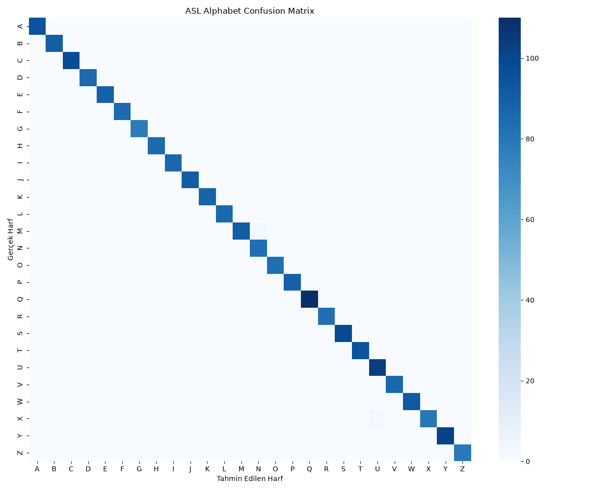

# ASL Alphabet Recognition & Word Builder

Amerikan İşaret Dili (ASL) alfabesindeki tek elle yapılan 26 harfi (A–Z) derin öğrenme ile tanıyan ve ardışık tahminlerden kelime oluşturan bilgisayarlı görü uygulaması.

---

## Proje Özeti

Bu proje, el hareketlerinden gerçek zamanlı veya yüklenen görseller üzerinden harf tespiti yaparak erişilebilir iletişimi desteklemeyi amaçlamaktadır. ImageNet üzerinde ön eğitimli **ResNet18** mimarisi Transfer Learning yöntemiyle 26 sınıflı ASL veri setine uyarlanmış ve **Gradio** tabanlı etkileşimli bir web arayüzü ile sunulmuştur.

* **Problem Türü:** Çok Sınıflı Görüntü Sınıflandırma (26 Sınıf: A–Z)
* **Veri Seti:** [ASL Alphabet Dataset (Kaggle)](https://www.kaggle.com/datasets/grassknoted/asl-alphabet) — Sınıf başına 600 görüntü, toplam 15.600 görüntü (%70 Eğitim, %15 Doğrulama, %15 Test)
* **Model Mimarisi:** ResNet18 (Transfer Learning)
* **Giriş Boyutu:** 224 × 224 × 3 (RGB)
* **Arayüz:** Gradio Web Uygulaması

---

## Performans Metrikleri

Model, yerel donanım (CPU) üzerinde 8 epoch boyunca eğitilmiş ve 7. epoch sonunda en yüksek doğrulama başarısına ulaşmıştır.

| Metrik | Değer |
| :--- | :--- |
| **Test Accuracy** | %99.66 |
| **Macro Precision** | 0.9967 |
| **Macro Recall** | 0.9965 |
| **Macro F1-Score** | 0.9965 |
| **Training Time** | 14636.76 saniye |
| **Inference Time** | 33.16 ms / görüntü |

### Karmaşıklık Matrisi (Confusion Matrix)



---

## Gerçek Dünya Test Sonuçları

Eğitim veri seti dışından, telefon kamerasıyla çekilen 5 farklı el fotoğrafı (`H`, `A`, `Y`, `R`, `U`) Gradio arayüzü üzerinden test edilmiştir:

| Test No | Hedef Harf | Model Tahmini | Güven Oranı | Durum |
| :---: | :---: | :---: | :---: | :---: |
| 1 | H | H | %100 | Başarılı |
| 2 | A | A | %100 | Başarılı |
| 3 | Y | Y | %97 | Başarılı |
| 4 | R | R | %84 | Başarılı |
| 5 | U | H | %96 | Başarısız |

* **Değerlendirme:** H, A, Y ve R harfleri sade arka plan ve belirgin parmak geometrisi sayesinde yüksek doğrulukla sınıflandırılmıştır. U ve H harfleri ise iki bitişik parmak yapısının yönelim (dikey/yatay) farkına dayandığı için veri artırma (RandomRotation) etkisiyle birbirine karıştırılmıştır.

---

## Proje Yapısı

```text
asl-sign-language-recognition/
├── download_data.py       # Kaggle üzerinden veri setini indirir ve 26 sınıfı dengeli olarak ayıklar
├── train.py               # Veri ön işleme, ResNet18 eğitimi, test metrikleri ve confusion matrix üretimi
├── app.py                 # Eğitilmiş modeli yükleyen Gradio web arayüzü ve kelime oluşturucu
├── confusion_matrix.png   # Test kümesi karmaşıklık matrisi çıktısı
├── requirements.txt       # Gerekli Python kütüphaneleri
└── README.md              # Proje dokümantasyonu
